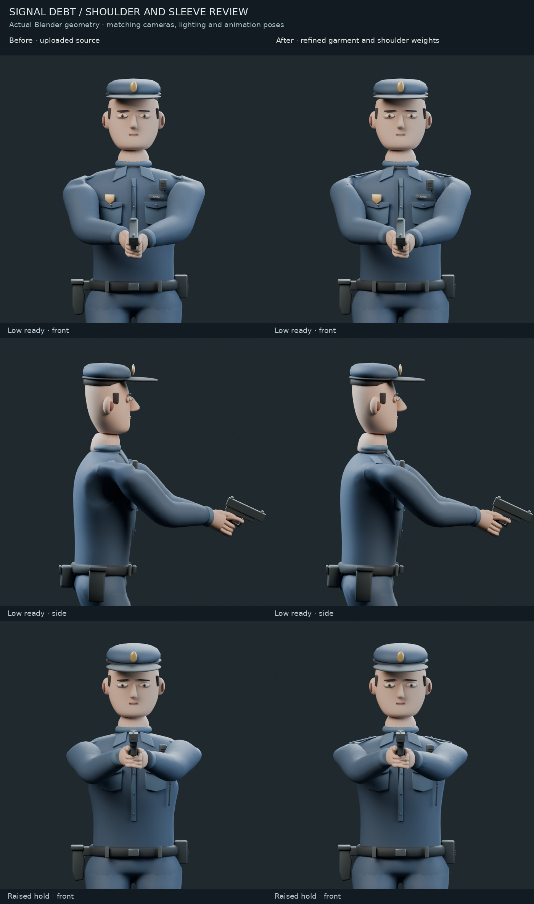
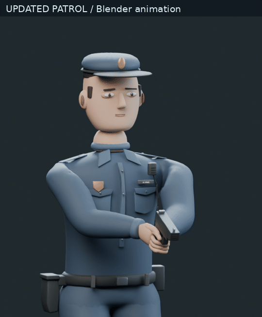
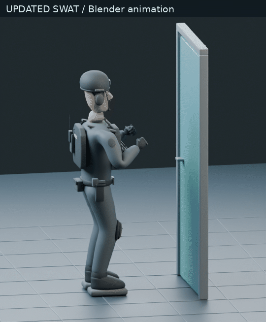
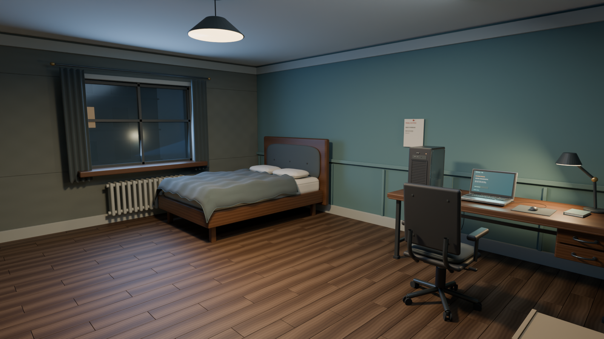
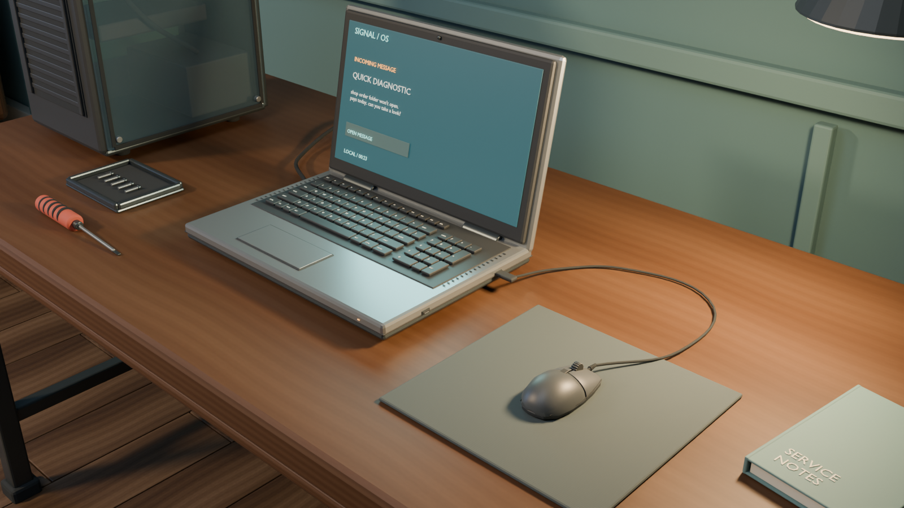
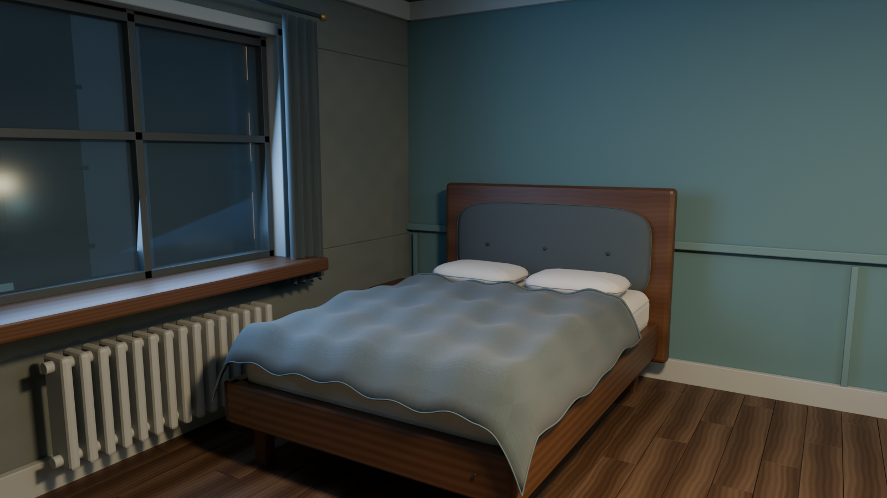

# Signal Debt — visual review

These are images rendered from the project's actual Blender scenes. The comparison
uses the same camera and lighting on the uploaded and revised character sources.
The GIFs show sampled frames from the authored animations; the FBX clips retain
their original 30 fps timing. Click an image to inspect it at full size.

## Shoulder comparison

The labels distinguish the uploaded model from the revised shoulder geometry,
cloth weights and epaulet construction. Repeated poses are intentional comparisons.

## Updated motion

Patrol grip and lowered/raised transition:

SWAT kick:

Small armhole cloth folds remain. These previews do not establish Unity playback,
runtime animation blending or finished cloth simulation.

## Updated apartment

Room overview:

Workstation detail:

Bed and upholstery:

These new apartment views use Blender 5.2.2 LTS with denoising. The original
uploaded previews are preserved in `Blender/Previews`; they use different render
settings, so they should not be confused with these new images.

Read [the quality-pass notes](Documentation/Quality_Pass_2026-10-04.md) for changes,
source provenance, tests and remaining Unity checks. Reports in `Validation`
identify the source and image hashes used for the current review.
